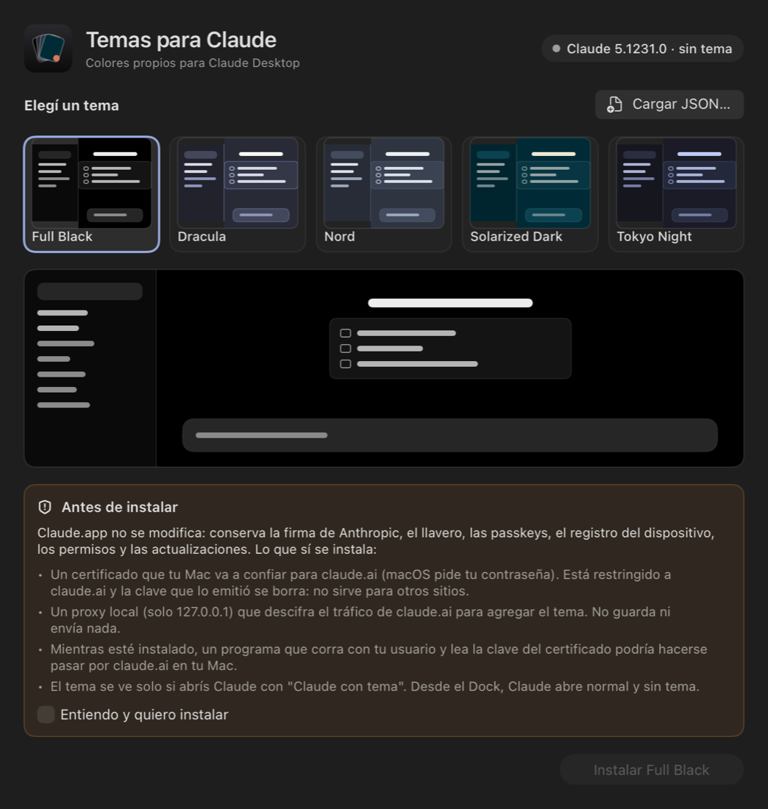
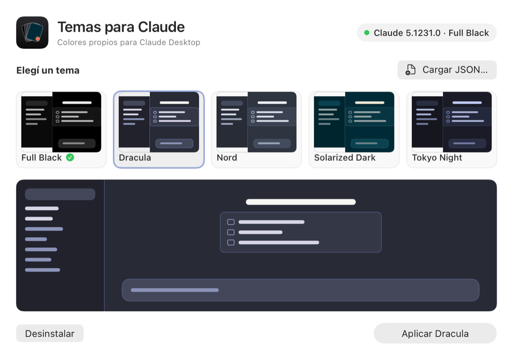

# Temas para Claude Desktop

Colores propios para la app de escritorio de Claude en macOS: Full Black, Dracula, Nord, Solarized Dark, Tokyo Night, o tu propio JSON.

> **No es oficial.** Este proyecto no está hecho ni respaldado por Anthropic. Desde la versión 2 **no modifica Claude.app**, pero instala un certificado de confianza y un proxy local para claude.ai. Leé [qué se instala](#qué-se-instala-y-qué-riesgo-tiene) antes de usarlo.

<p align="center">
  
  
</p>

## Instalar

1. Descargá **[Temas-para-Claude.zip](https://github.com/shadownrx/claude-desktop-themes/releases/latest/download/Temas-para-Claude.zip)** y descomprimilo.
2. Abrí **Temas para Claude**. La primera vez macOS la bloquea porque no está firmada por un desarrollador de Apple: andá a **Ajustes del Sistema → Privacidad y seguridad** y tocá **Abrir igualmente**.
3. Elegí un tema, marcá **Entiendo y quiero instalar** y tocá **Instalar**. macOS te pide tu contraseña para confiar el certificado de claude.ai.
4. Tocá **Abrir Claude con tema**. También queda **Claude con tema** en `~/Applications`, que podés arrastrar al Dock.
5. En Claude, poné la apariencia en **modo oscuro**. Los temas solo se aplican ahí.

**Requisitos:** macOS 14 o posterior, Claude Desktop en `/Applications` y [Node.js](https://nodejs.org) (`brew install node`). Probado con Claude 5.1231.0.

## Qué se instala y qué riesgo tiene

Claude Desktop no tiene temas. Su interfaz es la página `https://claude.ai`, así que el tema se agrega en el camino:

- **Proxy local.** Escucha solo en `127.0.0.1:8737` y corre como agente de launchd (`local.claude-desktop-themes.proxy`). Solo atiende `claude.ai` y rechaza cualquier otro destino. **Descifra el tráfico de claude.ai** para agregar un `<style>` en las páginas HTML; lo demás pasa sin cambios: API, streaming y WebSockets. No guarda ni envía contenido. El log (`~/.claude/desktop-themes/proxy.log`) registra solo arranques, inyecciones y errores.
- **Certificado de confianza para claude.ai.** Se genera en tu Mac, sobre una CA local restringida por *name constraints* a `claude.ai`. La clave privada de la CA se borra apenas firma el certificado, así que nadie puede emitir otros certificados con ella. macOS te pide la contraseña para confiar en ella (solo para SSL).
- **El riesgo que queda.** Mientras esté instalado, la clave del certificado de claude.ai está en `~/.claude/desktop-themes/tls/claude.ai.key`, legible solo por tu usuario. Un programa malicioso que corra con tu usuario y la lea podría hacerse pasar por claude.ai en tu Mac. Ese mismo programa ya podría leer tus cookies, pero es una puerta más: si no la necesitás, desinstalá.
- **Lanzador.** **Claude con tema** abre Claude con `--proxy-pac-url`, y solo `claude.ai` pasa por el proxy. Si abrís Claude desde el Dock, funciona normal y sin tema. Si el proxy no responde, Claude se conecta directo.

**Claude.app no se toca.** Conserva la firma de Anthropic, el hardened runtime, el acceso al llavero, las passkeys, el registro del dispositivo en el Secure Enclave, el conector de Microsoft 365, los permisos de macOS y las actualizaciones automáticas.

## Cambiar de tema

Abrí la app, elegí otro tema y tocá **Aplicar**. Después apretá `Cmd+R` en Claude.

## Tu propio tema

Tocá **Cargar JSON…** y elegí un archivo así (solo `background` es obligatorio; los colores van en hex):

```json
{
  "name": "Mi tema",
  "colors": {
    "background": "#000000",
    "sidebar": "#0a0a0a",
    "card": "#141414",
    "popover": "#1a1a1a",
    "input": "#262626",
    "border": "#333333",
    "text": "#ffffff",
    "textSecondary": "#d4d4d4",
    "textMuted": "#a3a3a3"
  }
}
```

| Clave | Qué pinta | Si falta, usa |
|---|---|---|
| `background` | Fondo principal | (obligatoria) |
| `sidebar` | Barra lateral | `background` |
| `card` | Tarjetas y hover | `sidebar` |
| `popover` | Menús desplegables | `card` |
| `input` | Caja de texto y botones | `popover` |
| `border` | Bordes | `input` |
| `text`, `textSecondary`, `textMuted` | Texto | colores de Claude |

En [`themes/`](themes) están los temas incluidos como ejemplo.

## Desinstalar

Abrí la app y tocá **Desinstalar**. Se borran el agente del proxy, el certificado del llavero, la clave, el lanzador y los archivos del proxy. Quedan tus temas en `~/.claude/desktop-themes`. Claude no cambió, así que solo tenés que volver a abrirlo normal.

## Si usaste la versión 1.0

La 1.0 **modificaba Claude.app**: lo firmaba ad hoc y le quitaba entitlements. Con eso se perdían las passkeys, el conector de Microsoft 365 y el registro del dispositivo en el Secure Enclave, que permite usar tu Mac desde Claude en otros dispositivos. Además, sin hardened runtime, otros procesos podían inyectar código en Claude.

La versión 2 lo detecta. Al tocar **Instalar**, primero restaura el Claude.app original de Anthropic desde la copia que guardó la 1.0, en `~/claude-desktop-theme/backup-<versión>/`. Para eso Claude tiene que estar cerrado, y macOS puede pedir el permiso **Gestión de apps**. Si no está la copia, reinstalá Claude desde [claude.ai/download](https://claude.ai/download).

## Windows (beta)

> **Beta sin probar en Windows.** Se escribió y revisó en macOS. Es el mismo mecanismo (proxy local y certificado restringido a claude.ai), pero los scripts de PowerShell nunca corrieron en Windows real. Si algo falla, desinstalá y abrí un issue.

1. Instalá [Node.js](https://nodejs.org) (`winget install OpenJS.NodeJS.LTS`).
2. Descargá **Temas-para-Claude-Windows-beta.zip** de la [release beta](https://github.com/shadownrx/claude-desktop-themes/releases) y descomprimilo.
3. Doble clic en **instalar-windows.cmd**. Escribí `SI` y confirmá el aviso de seguridad de Windows sobre el certificado.
4. Abrí Claude con **Claude con tema** desde el menú Inicio y poné la apariencia en modo oscuro.

Cambiar de tema: `instalar-windows.cmd -Theme mi-tema.json` y `Ctrl+R` en Claude. Desinstalar: `instalar-windows.cmd -Uninstall`.

Diferencias con macOS:

- **Sin interfaz:** solo hay scripts.
- **Arranque del proxy:** lo arranca un `.vbs` en la carpeta Inicio, en lugar de launchd.
- **Certificado:** sale de `New-SelfSignedCertificate`. El instalador verifica que la CA quede restringida a `claude.ai` antes de confiarla; si no lo está, no instala nada.
- **Cómo se abre Claude:** el lanzador busca `%LOCALAPPDATA%\AnthropicClaude\claude.exe` o el alias del paquete MSIX en `%LOCALAPPDATA%\Microsoft\WindowsApps`. Que el alias del MSIX le pase `--proxy-pac-url` a Claude es justo lo que falta comprobar.

## Sin interfaz (Terminal)

[`instalar-tema-claude.command`](instalar-tema-claude.command) hace lo mismo desde Terminal; la app lo usa por dentro. Necesita la carpeta [`proxy/`](proxy) a su lado (cloná el repo):

```sh
zsh instalar-tema-claude.command                     # instalar
zsh instalar-tema-claude.command --theme mi.json     # cambiar de tema
zsh instalar-tema-claude.command --uninstall         # desinstalar
```

## Cómo funciona

- [`proxy/cdt-proxy.js`](proxy/cdt-proxy.js) es el proxy, en Node y sin dependencias. Sirve `/proxy.pac`, que manda solo `claude.ai` al proxy. Termina TLS con el certificado local y reenvía cada pedido a claude.ai. En las respuestas HTML de navegación agrega `<style id="cdt-theme">` antes de `</head>`.
- [`proxy/theme-json.js`](proxy/theme-json.js) convierte el JSON en CSS que pisa las variables de color de claude.ai: `--cds-gray-*`, `--cds-hsl-gray-*`, `--cds-surface-*` y `--cds-fizzy-lake-color-*`. El tema se relee en cada carga, así que `Cmd+R` alcanza.
- [`proxy/gen-cert.sh`](proxy/gen-cert.sh) genera la CA restringida y el certificado de claude.ai, y borra la clave de la CA.
- [`proxy/abrir-claude.sh`](proxy/abrir-claude.sh) es el lanzador. Si Claude está abierto sin tema, pregunta antes de reiniciarlo.
- Funciona por estas condiciones, comprobadas con Claude 5.1231.0:
  - Claude no bloquea `--proxy-pac-url`.
  - Su verificación de certificados solo rechaza una lista fija de CAs.
  - La CSP de claude.ai no restringe estilos.
  - Los CSS no usan SRI.

Si claude.ai cambia sus variables de color o agrega `style-src` a su CSP, el tema deja de verse, sin romper nada más.

## Compilar la app

```sh
zsh gui/build.sh   # genera gui/build/Temas para Claude.app y Temas-para-Claude.zip
```

Necesita las Command Line Tools de Xcode (`xcode-select --install`).
